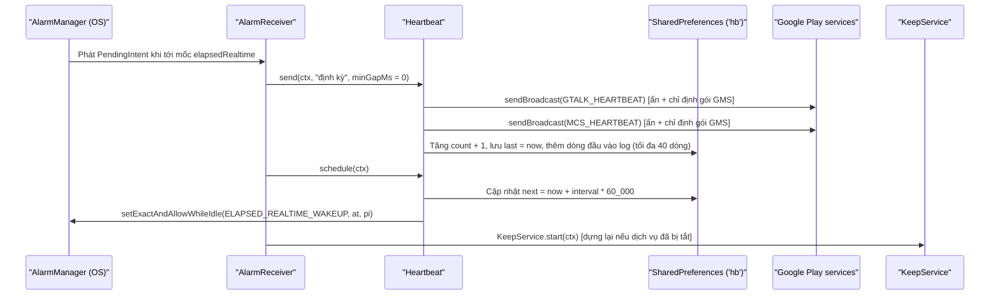
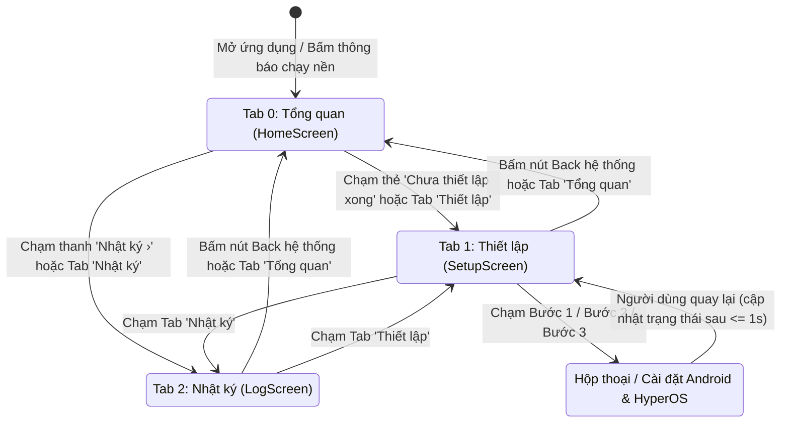

# CODEBASE.md — Tài liệu Kiến trúc & Mã nguồn Toàn diện: Giữ Thông Báo (`GiuThongBao`)

> **Định danh gói ứng dụng**: `vn.trungthanh.giuthongbao`  
> **Tên hiển thị**: `Giữ Thông Báo`  
> **Nền tảng**: Android Native (Kotlin + Jetpack Compose, `minSdk = 26`, `targetSdk = 36`, `compileSdk = 36`)  
> **Bản chất kỹ thuật cốt lõi**: Ứng dụng duy trì kết nối thông báo đẩy **Google Firebase Cloud Messaging (FCM / GCM MCS)** trên các bản ROM Android quản lý nền cực đoan (đặc biệt là **Xiaomi HyperOS nội địa / MIUI**), thông qua cơ chế phát sóng `GTALK_HEARTBEAT` / `MCS_HEARTBEAT` kết hợp `ForegroundService` (`specialUse`) và `AlarmManager` (`USE_EXACT_ALARM`).

---

## 1. Tổng quan Dự án (Project Overview)

### 1.1. Bài toán thực tế & Giải thích rõ bản chất kỹ thuật

> **Lưu ý quan trọng tránh nhầm lẫn tên gọi**: Mặc dù tên ứng dụng là **Giữ Thông Báo** (`GiuThongBao`), ứng dụng này **HOÀN TOÀN KHÔNG sử dụng `NotificationListenerService`**, không đọc, không chặn, không lọc và không lưu trữ nội dung thông báo cá nhân của người dùng vào cơ sở dữ liệu. Chữ *"Giữ"* ở đây mang nghĩa **giữ cho đường truyền thông báo đẩy (Push Connection) luôn sống, không bị đứt quãng**.

- **Vấn đề thực tế trên thiết bị**:
  - Trên Android, mọi thông báo đẩy từ các ứng dụng phổ biến (Messenger, Gmail, ngân hàng, Telegram bản Play Store, Zalo phụ thuộc FCM...) đều đi qua một kết nối TCP duy trì dài hạn (persistent socket) do **Google Play services (`com.google.android.gms`)** quản lý tới máy chủ `mtalk.google.com:5228` (giao thức MCS — *Mobile Connection Server*).
  - Trên các bản **ROM Xiaomi HyperOS nội địa (China ROM)** hoặc MIUI, cơ chế đóng băng tiến trình nền và cắt kết nối mạng khi ngủ (Doze / Freezer) thường làm Google Play services mất kết nối `mtalk.google.com:5228` (nhất là khi chuyển đổi Wi-Fi ↔ 4G/5G, mất sóng tạm thời, hoặc máy ngủ sâu) và **quên đặt lại bộ hẹn giờ kết nối lại (reconnect alarm)**. Hệ quả là điện thoại bị trễ hoặc mất thông báo hàng giờ liền cho tới khi người dùng mở sáng màn hình hoặc mạng tự khởi tạo lại.
- **Giải pháp của `GiuThongBao`**:
  - Chủ động gửi cặp System Broadcast nội bộ của Google (`com.google.android.intent.action.GTALK_HEARTBEAT` và `com.google.android.intent.action.MCS_HEARTBEAT`) tới `com.google.android.gms` — tương đương về mặt kỹ thuật với lệnh `adb shell am broadcast -a com.google.android.intent.action.MCS_HEARTBEAT`.
  - Khi nhận được broadcast này, Google Play services lập tức gửi gói tin kiểm tra (heartbeat ping) trên socket `mtalk.google.com:5228`; nếu socket đã chết hoặc treo (half-open TCP), GMS sẽ buộc phải đóng socket cũ và thiết lập lại kết nối FCM ngay lập tức.
  - Kết hợp **3 mũi nhọn đánh thức**:
    1. **Định kỳ xuyên Doze** bằng `AlarmManager.setExactAndAllowWhileIdle` (chu kỳ tùy chọn `3`, `5`, `10`, hoặc `15` phút).
    2. **Theo sự kiện thời gian thực** bằng `KeepService` (`ForegroundService` giữ tiến trình sống trên HyperOS) bắt đúng 2 thời điểm FCM dễ rớt nhất: **có mạng mới** (`ConnectivityManager.NetworkCallback.onAvailable`) và **mở khóa máy** (`Intent.ACTION_USER_PRESENT`).
    3. **Khởi động cùng hệ thống & Tự phục hồi lẫn nhau** qua `BootReceiver` (`BOOT_COMPLETED`, `MY_PACKAGE_REPLACED`) và cơ chế `AlarmReceiver` tự dựng lại `KeepService` nếu bị ROM giết.
- **Đối tượng sử dụng & Bối cảnh vận hành**:
  - Người dùng điện thoại Android xách tay / ROM nội địa Trung Quốc (trọng tâm là **Xiaomi chạy HyperOS** và MIUI) tại Việt Nam, cài đặt trực tiếp qua file `.apk` (sideload).
  - Giao diện tiếng Việt 100%, cung cấp kèm màn hình **Thiết lập** dẫn thẳng vào các màn cấu hình ẩn của MIUI/HyperOS (`AutoStartManagementActivity`, `HIDDEN_APPS_CONFIG_ACTIVITY`) để người dùng cấp đủ quyền chạy nền chỉ với vài thao tác chạm.

### 1.2. Bảng Tech Stack Chi tiết

Dự án không sử dụng file catalog `gradle/libs.versions.toml` mà khai báo trực tiếp phiên bản plugin và thư viện tinh gọn tại `build.gradle.kts`, `app/build.gradle.kts` và `gradle/wrapper/gradle-wrapper.properties`:

| Thành phần | Công nghệ / Thư viện | Phiên bản cụ thể | Nguồn khai báo & Vai trò |
| :--- | :--- | :--- | :--- |
| **Ngôn ngữ lập trình** | Kotlin (Android) | `2.2.20` | `build.gradle.kts` (`org.jetbrains.kotlin.android`) |
| **Compose Compiler** | Kotlin Compose Plugin | `2.2.20` | `build.gradle.kts` (`org.jetbrains.kotlin.plugin.compose`) |
| **Hệ thống Build** | Gradle Wrapper | `9.1.0` (`all`) | `gradle/wrapper/gradle-wrapper.properties` |
| **Android Gradle Plugin** | `com.android.application` | `8.13.0` | `build.gradle.kts` |
| **JDK / JVM Target** | Java / JVM Bytecode | `17` (`VERSION_17` / `JVM_17`) | `app/build.gradle.kts` |
| **Android SDK** | `minSdk` / `targetSdk` / `compileSdk` | `26` / `36` / `36` | `app/build.gradle.kts` (Android 8.0 Oreo → Android 16) |
| **AndroidX Core** | `androidx.core:core-ktx` | `1.15.0` | `app/build.gradle.kts` (`ServiceCompat.startForeground`) |
| **Activity Compose** | `androidx.activity:activity-compose` | `1.10.1` | `app/build.gradle.kts` (`ComponentActivity`, `enableEdgeToEdge`, `BackHandler`) |
| **Compose BOM** | `androidx.compose:compose-bom` | `2025.05.00` | `app/build.gradle.kts` (Đồng bộ phiên bản toàn bộ Compose + Coroutines) |
| **Compose UI** | `androidx.compose.ui:ui` | Theo BOM `2025.05.00` | Dựng Canvas, `PathParser` vẽ icon vector nét mảnh, Modifier, Typography |
| **Compose Foundation** | `androidx.compose.foundation:foundation` | Theo BOM `2025.05.00` | Layout (`Column`, `Row`, `Box`, `LazyColumn`), scroll, border, clickable |
| **Compose Material 3** | `androidx.compose.material3:material3` | Theo BOM `2025.05.00` | `MaterialTheme`, `darkColorScheme`, `Text` |
| **Lưu trữ cục bộ** | Android `SharedPreferences` | SDK tích hợp sẵn | 2 file XML nội bộ (`"hb"` và `"setup"`), không dùng Room/SQLite |
| **Hệ thống Icon** | Custom SVG `PathParser` (`Ic`) + XML Vector | Tự cài đặt (0 thư viện ngoài) | Không phụ thuộc `material-icons-extended`, giảm tối đa dung lượng APK |

### 1.3. Thông tin Kho mã nguồn Git

- **Trạng thái kho Git hiện tại**: Thư mục `d:\Project\GiuThongBao` (cũng như thư mục cha `d:\Project`) hiện **chưa khởi tạo kho `.git`** (chưa có commit history hay remote URL).
- **Cấu hình `.gitignore` sẵn có**: Dự án đã chuẩn bị sẵn tệp `.gitignore` (20 dòng) loại trừ:
  - Thư mục sinh tự động khi build: `/build/`, `/app/build/`, `/.gradle/`, `/.kotlin/`, `local.properties`.
  - Tạo phẩm đóng gói: `*.apk`, `*.idsig`.
  - Tệp cấu hình IDE / OS: `/.idea/`, `*.iml`, `.DS_Store`.
  - Thư mục phục vụ nghiên cứu / dịch ngược ban đầu: `/capture/`, `/samples/`.

---

## 2. Kiến trúc Tổng thể & Luồng Dữ liệu (Architecture & End-to-End Data Flow)

### 2.1. Sơ đồ Kiến trúc Tổng thể

Toàn bộ ứng dụng chạy trong **một tiến trình Android duy nhất** (`vn.trungthanh.giuthongbao`) gồm 4 lớp rõ rệt:
1. **Tầng Kích hoạt Hệ thống (System Triggers & Background Survival)**: `BootReceiver`, `AlarmReceiver`, `KeepService` (`screenReceiver` + `netCallback`).
2. **Tầng Lõi Nghiệp vụ & Điều phối (Core Domain Singleton)**: `object Heartbeat`.
3. **Tầng Lưu trữ & Trạng thái Chia sẻ (Persistence & In-Process State)**: `SharedPreferences("hb")`, `SharedPreferences("setup")`, biến bộ nhớ `@Volatile KeepService.running` và `@Volatile Heartbeat.lastSentElapsed`.
4. **Tầng Giao diện Người dùng (Jetpack Compose UI)**: `MainActivity`, `HomeScreen`, `SetupScreen`, `LogScreen` và bộ Design System trong `Ui.kt`.

```mermaid
flowchart TD
    subgraph AndroidOS["Hệ điều hành Android / HyperOS"]
        BootEvt["BOOT_COMPLETED / MY_PACKAGE_REPLACED"]
        AlarmMgr["AlarmManager (ELAPSED_REALTIME_WAKEUP)"]
        UnlockEvt["ACTION_USER_PRESENT (Mở khóa màn hình)"]
        NetEvt["ConnectivityManager (NetworkCallback.onAvailable)"]
        PowerMgr["PowerManager & Cài đặt MIUI SecurityCenter"]
        GMS["Google Play services (com.google.android.gms - mtalk:5228)"]
    end

    subgraph AppProcess["Tiến trình ứng dụng vn.trungthanh.giuthongbao"]
        subgraph ReceiversLayer["Tầng Thu nhận & Duy trì Nền"]
            BootRcv["BootReceiver (Receivers.kt)"]
            AlarmRcv["AlarmReceiver (Receivers.kt)"]
            KeepSvc["KeepService - ForegroundService specialUse (KeepService.kt)"]
        end

        subgraph CoreLayer["Tầng Lõi Điều phối"]
            HB["object Heartbeat (Heartbeat.kt)"]
        end

        subgraph StorageLayer["Tầng Lưu trữ & Trạng thái"]
            PrefsHB["SharedPreferences ('hb')"]
            PrefsSetup["SharedPreferences ('setup')"]
            RunFlag["@Volatile KeepService.running"]
        end

        subgraph UILayer["Tầng Giao diện Jetpack Compose"]
            MainAct["MainActivity (Chu kỳ đọc readStatus mỗi 1 giây)"]
            HomeScr["HomeScreen - Tab 0 (Tổng quan)"]
            SetupScr["SetupScreen - Tab 1 (Thiết lập)"]
            LogScr["LogScreen - Tab 2 (Nhật ký)"]
        end
    end

    BootEvt --> BootRcv
    AlarmMgr --> AlarmRcv
    UnlockEvt --> KeepSvc
    NetEvt --> KeepSvc

    BootRcv -->|"send + schedule + start"| HB
    BootRcv -->|"startForegroundService"| KeepSvc
    AlarmRcv -->|"send('định kỳ') + schedule"| HB
    AlarmRcv -->|"Tự hồi sinh KeepService"| KeepSvc
    KeepSvc -->|"send('mở máy' / 'có mạng mới')"| HB
    KeepSvc -->|"Cập nhật true/false"| RunFlag

    HB -->|"4 Broadcasts: GTALK_HEARTBEAT & MCS_HEARTBEAT"| GMS
    HB -->|"Đặt lại hẹn giờ kế tiếp"| AlarmMgr
    HB <-->|"Đọc/ghi interval, count, last, next, log"| PrefsHB

    MainAct -->|"onCreate: start + schedule"| KeepSvc
    MainAct -->|"onCreate / onInterval / onWake"| HB
    MainAct <-->|"Đọc/ghi autostart, battery"| PrefsSetup
    MainAct <-->|"Kiểm tra & mở Intent cấu hình"| PowerMgr
    MainAct <-- "Đọc trực tiếp trong RAM" --- RunFlag
    MainAct <-- "Đọc entries & thông số mỗi 1s" --- HB

    MainAct --> HomeScr
    MainAct --> SetupScr
    MainAct --> LogScr
```

### 2.2. Cơ chế Giao tiếp Giữa Các Tầng

- **Không dùng IPC / Binder / Broadcast nội bộ rườm rà giữa Service và Activity**: Vì `MainActivity`, `KeepService`, `AlarmReceiver` và `BootReceiver` đều chạy chung tiến trình mặc định `vn.trungthanh.giuthongbao`, trạng thái sống của dịch vụ nền được chia sẻ trực tiếp qua thuộc tính `@Volatile var running: Boolean` trên `KeepService.companion`.
- **Đồng bộ dữ liệu UI theo mô hình Polling nhẹ (1 giây/lần)**: Thay vì dùng `SharedPreferences.OnSharedPreferenceChangeListener` hay `Flow`/`LiveData`, `MainActivity.App()` dùng `LaunchedEffect(Unit)` gọi `readStatus()` mỗi `1000ms` để chụp lại một bất biến `data class Status(...)`. Thiết kế này vừa cập nhật bộ đếm ngược từng giây (`MM:SS`) trên vòng tròn tiến độ `HeroCard`, vừa tự động nhận diện thay đổi từ `AlarmReceiver`, `KeepService`, hoặc kết quả cấp quyền tối ưu pin khi người dùng quay lại từ trình Cài đặt hệ thống.
- **Cơ chế Tự Phục Hồi Kép (Mutual Self-Healing)**:
  - `KeepService` giữ tiến trình ở mức ưu tiên Foreground (`START_STICKY`) để HyperOS hạn chế giết tiến trình và không xóa lịch `AlarmManager`.
  - Ngược lại, nếu HyperOS vẫn cưỡng bức giết `KeepService` khi thiếu RAM, đến kỳ hẹn giờ tiếp theo `AlarmManager` sẽ đánh thức `AlarmReceiver`; bên trong `AlarmReceiver.onReceive()`, hàm `KeepService.start(ctx)` được gọi lại hợp lệ (nhờ quyền miễn trừ nền của `USE_EXACT_ALARM` / `REQUEST_IGNORE_BATTERY_OPTIMIZATIONS`) để dựng lại `KeepService`.

### 2.3. Chi tiết Các Luồng Nghiệp vụ End-to-End

#### Luồng 1: Khởi động Ứng dụng Lần đầu / Mở Giao diện (`MainActivity.onCreate`)
1. Thiết lập chế độ tràn viền `enableEdgeToEdge` với thanh trạng thái tối (`Bg = #0E0E10`) và thanh điều hướng tối (`NavBg = #141416`).
2. Nếu thiết bị chạy Android 13 trở lên (`SDK_INT >= 33`), gọi `requestPermissions(POST_NOTIFICATIONS)` để thông báo chạy nền của `KeepService` được phép hiển thị.
3. Gọi `KeepService.start(this)` → kích hoạt `startForegroundService` → `KeepService.onCreate()` đặt `running = true`, tạo kênh thông báo `"keep"` (`IMPORTANCE_MIN`), gọi `ServiceCompat.startForeground` với kiểu `FOREGROUND_SERVICE_TYPE_SPECIAL_USE` (trên API 34+), đăng ký `screenReceiver` (`ACTION_USER_PRESENT`) và `netCallback` (`registerDefaultNetworkCallback`).
4. Gọi `Heartbeat.schedule(this)` → đọc chu kỳ `interval` từ `SharedPreferences("hb")` (mặc định `5` phút), ghi mốc dự kiến `next = now + delayMs` vào `"hb"`, và đặt hẹn giờ `AlarmManager.setExactAndAllowWhileIdle` (hoặc `setAndAllowWhileIdle` nếu không có quyền exact alarm).
5. Khởi chạy cây giao diện Compose `App()`, chụp `Status` lần đầu và bắt đầu vòng lặp `delay(1000); refresh()`.

#### Luồng 2: Đánh thức Định kỳ qua `AlarmManager`


#### Luồng 3: Đánh thức Theo Sự kiện Mạng mới & Mở khóa Màn hình (Chống gửi dồn — Debounce)
- **Khi có kết nối mạng mới** (bật Wi-Fi, chuyển Wi-Fi sang 4G/5G, vừa ra khỏi thang máy có sóng lại):
  1. Hệ thống gọi `KeepService.netCallback.onAvailable(network)` trên luồng `ConnectivityThread`.
  2. Gọi `Heartbeat.send(this@KeepService, "có mạng mới", minGapMs = 20_000)`.
  3. `Heartbeat.send()` kiểm tra `SystemClock.elapsedRealtime() - lastSentElapsed < 20_000`. Nếu vừa gửi cách đây chưa tới 20 giây (do mạng chập chờn nhảy liên tục), hàm thoát sớm (`return`), bảo vệ pin và tránh spam broadcast. Nếu đã quá 20 giây, cập nhật `lastSentElapsed = now`, bắn 4 broadcast tới GMS và ghi nhật ký `"có mạng mới"`.
- **Khi người dùng mở khóa màn hình**:
  1. Hệ thống phát `Intent.ACTION_USER_PRESENT` tới `KeepService.screenReceiver`.
  2. Gọi `Heartbeat.send(ctx, "mở máy", minGapMs = 2 * 60_000)` (chống gửi dồn trong vòng **2 phút** nếu người dùng bật/tắt màn hình liên tục).

#### Luồng 4: Khởi động lại Thiết bị hoặc Cập nhật APK (`BootReceiver`)
1. Hệ thống phát `ACTION_BOOT_COMPLETED` hoặc `ACTION_MY_PACKAGE_REPLACED`.
2. `BootReceiver.onReceive` phân biệt action để ghi lý do `"khởi động máy"` hoặc `"cập nhật app"`, gọi `Heartbeat.send(...)` ngay lập tức (`minGapMs = 0`).
3. Gọi `Heartbeat.schedule(ctx)` để đăng ký lại lịch `AlarmManager` (vì Android xóa toàn bộ alarm khi tắt nguồn).
4. Gọi `KeepService.start(ctx)` để khởi chạy lại dịch vụ nền.

#### Luồng 5: Tương tác Thủ công trên Giao diện Người dùng
- **Đổi chu kỳ đánh thức (`IntervalPicker` — 3 / 5 / 10 / 15 phút)**: Gọi `Heartbeat.setIntervalMin(ctx, it)` → lưu `"interval"` mới vào `"hb"` → gọi `Heartbeat.schedule(ctx)` cập nhật ngay `AlarmManager` và mốc `"next"` → gọi `refresh()` để vòng tròn đếm ngược nhảy ngay sang chu kỳ mới.
- **Bấm nút `"Đánh thức ngay"` (`WakeButton`)**: Gọi `Heartbeat.send(ctx, "bấm tay")` (`minGapMs = 0`, luôn thực thi ngay lập tức không bị chặn bởi debounce) → gọi `refresh()` để tăng `"Tổng số lần"` và cập nhật dòng nhật ký mới nhất ngay trên màn hình.
- **Thực hiện 3 bước Thiết lập HyperOS (`SetupScreen`)**:
  - Bước 1 (*Bỏ tối ưu pin*): Mở hộp thoại hệ thống `ACTION_REQUEST_IGNORE_BATTERY_OPTIMIZATIONS`. Trạng thái hoàn thành được kiểm tra thực tế từ `PowerManager.isIgnoringBatteryOptimizations(packageName)`.
  - Bước 2 (*Bật Tự khởi động*): Ghi cờ `autostart = true` vào `SharedPreferences("setup")`, mở `com.miui.securitycenter/com.miui.permcenter.autostart.AutoStartManagementActivity` (nếu lỗi/không phải máy Xiaomi thì tự chuyển về trang *Thông tin ứng dụng* `ACTION_APPLICATION_DETAILS_SETTINGS`).
  - Bước 3 (*Pin: Không hạn chế*): Ghi cờ `battery = true` vào `SharedPreferences("setup")`, mở `miui.intent.action.HIDDEN_APPS_CONFIG_ACTIVITY` kèm `package_name` và `package_label` (fallback về `ACTION_APPLICATION_DETAILS_SETTINGS` nếu lỗi).

---

## 3. Cấu trúc Thư mục & Bản đồ Toàn bộ Tệp nguồn (Complete Directory & File Map)

### 3.1. Cây Thư mục Dự án

```text
GiuThongBao/
├── .gitignore                                           # Quy tắc loại trừ file build, APK, IDE, mẫu dịch ngược
├── build.gradle.kts                                     # Khai báo phiên bản AGP 8.13.0 & Kotlin/Compose 2.2.20
├── gradle.properties                                    # Cấu hình JVM heap 2GB, UTF-8, AndroidX, nonTransitiveRClass
├── gradlew                                              # Script chạy Gradle Wrapper trên Unix/macOS/Linux
├── gradlew.bat                                          # Script chạy Gradle Wrapper trên Windows
├── local.properties                                     # Đường dẫn Android SDK cục bộ trên máy phát triển (gitignored)
├── settings.gradle.kts                                  # Cấu hình kho lưu trữ Google/MavenCentral và module :app
├── gradle/
│   └── wrapper/
│       ├── gradle-wrapper.jar                           # Binary thực thi Gradle Wrapper
│       └── gradle-wrapper.properties                    # Cấu hình tải Gradle 9.1.0-all
└── app/
    ├── build.gradle.kts                                 # Cấu hình Android SDK 26..36, Java 17, Compose BOM 2025.05.00
    └── src/
        └── main/
            ├── AndroidManifest.xml                      # 7 quyền hệ thống, MainActivity, KeepService, 2 Receivers
            ├── java/
            │   └── vn/
            │       └── trungthanh/
            │           └── giuthongbao/
            │               ├── Heartbeat.kt             # Singleton lõi gửi broadcast FCM, lập lịch Alarm, lưu/đọc log
            │               ├── KeepService.kt           # ForegroundService giữ tiến trình + bắt mở khóa & có mạng mới
            │               ├── MainActivity.kt          # Activity chính, polling trạng thái 1s, điều hướng & Intent MIUI
            │               ├── Receivers.kt             # AlarmReceiver (định kỳ) & BootReceiver (khởi động/cập nhật)
            │               ├── Screens.kt               # Data class Status + 3 màn hình: HomeScreen, SetupScreen, LogScreen
            │               └── Ui.kt                    # Bảng màu, bộ 16 icon SVG nét mảnh, LineIcon, IconTile, BottomNav
            └── res/
                ├── drawable/
                │   ├── ic_bell.xml                      # Vector icon chuông trắng đơn sắc 24dp cho thanh thông báo
                │   ├── ic_launcher_background.xml       # Nền gradient tối cho Adaptive App Icon (108dp)
                │   └── ic_launcher_foreground.xml       # Tiền cảnh chuông vàng + chấm xanh lá cho App Icon (108dp)
                ├── mipmap-anydpi-v26/
                │   └── ic_launcher.xml                  # Khai báo Adaptive Icon (background + foreground + monochrome)
                └── values/                              # (Thư mục rỗng — toàn bộ chuỗi/màu/theme quản lý trực tiếp bằng Kotlin/Manifest)
```

### 3.2. Bảng Kê khai Đầy đủ Toàn bộ Tệp trong Dự án

Tổng cộng dự án có **21 tệp** (20 tệp văn bản mã nguồn/cấu hình/script/tài nguyên + 1 tệp nhị phân `gradle-wrapper.jar`), trong đó phần mã nguồn Kotlin gồm **6 tệp với tổng cộng đúng 1.036 dòng code**:

| STT | Đường dẫn tương đối | Số dòng / Kích thước | Vai trò chi tiết | Thành phần xuất ra / Khai báo chính |
| :---: | :--- | :---: | :--- | :--- |
| 1 | `.gitignore` | 20 dòng (225 B) | Loại trừ thư mục build, APK, cấu hình IDE, `local.properties` và thư mục `/capture/`, `/samples/` khỏi Git | Quy tắc gitignore |
| 2 | `settings.gradle.kts` | 19 dòng (331 B) | Khai báo `rootProject.name = "GiuThongBao"`, nạp module `:app` và khóa kho thư viện ở `google()`, `mavenCentral()` | `rootProject`, `include(":app")` |
| 3 | `build.gradle.kts` | 6 dòng (218 B) | Khai báo plugin cấp root (`apply false`): Android Application `8.13.0`, Kotlin Android `2.2.20`, Kotlin Compose `2.2.20` | Khối `plugins` gốc |
| 4 | `gradle.properties` | 7 dòng (185 B) | Tối ưu JVM `-Xmx2048m -Dfile.encoding=UTF-8`, bật build song song, build cache, AndroidX, `nonTransitiveRClass` | Thuộc tính Gradle toàn cục |
| 5 | `gradlew` | 161 dòng (4.971 B) | Shell script khởi chạy Gradle Wrapper trên môi trường POSIX (Linux/macOS/Git Bash) | CLI entrypoint Unix |
| 6 | `gradlew.bat` | 91 dòng (2.404 B) | Batch script khởi chạy Gradle Wrapper trên Windows CMD / PowerShell | CLI entrypoint Windows |
| 7 | `local.properties` | 2 dòng (31 B) | Chỉ định biến `sdk.dir` trỏ tới thư mục cài đặt Android SDK trên máy cục bộ (không chứa khóa bí mật) | `sdk.dir` |
| 8 | `gradle/wrapper/gradle-wrapper.properties` | 8 dòng (252 B) | Chỉ định URL phân phối `gradle-9.1.0-all.zip` và timeout mạng `10000ms` | Cấu hình Gradle Wrapper |
| 9 | `gradle/wrapper/gradle-wrapper.jar` | Nhị phân (53.636 B) | Thư viện Java thực thi tải và khởi chạy Gradle Wrapper (`GradleWrapperMain`) | `GradleWrapperMain` |
| 10 | `app/build.gradle.kts` | 50 dòng (1.219 B) | Cấu hình `namespace`/`applicationId` (`vn.trungthanh.giuthongbao`), SDK `26..36`, Java 17, bật Compose và khai báo 6 dependencies | Cấu hình build `:app` |
| 11 | `app/src/main/AndroidManifest.xml` | 52 dòng (2.139 B) | Khai báo 7 quyền hệ thống, tắt backup (`allowBackup="false"`), đăng ký `MainActivity`, `KeepService` (`specialUse`), `AlarmReceiver`, `BootReceiver` | Manifest ứng dụng |
| 12 | `app/src/main/java/vn/trungthanh/giuthongbao/Heartbeat.kt` | 103 dòng (4.401 B) | Trái tim của ứng dụng: phát broadcast đánh thức GMS, chống gửi dồn (`minGapMs`), lưu/phân tích nhật ký trong `SharedPreferences("hb")`, đặt lịch `AlarmManager` | `object Heartbeat`, `Heartbeat.Entry`, `INTERVALS_MIN`, `send()`, `schedule()`, `entries()`, `intervalMin()`, `setIntervalMin()`, `count()`, `lastTime()`, `nextTime()`, `log()` |
| 13 | `app/src/main/java/vn/trungthanh/giuthongbao/KeepService.kt` | 88 dòng (3.341 B) | Dịch vụ nền `ForegroundService` (`specialUse`, `START_STICKY`) giữ tiến trình sống trên HyperOS và lắng nghe mở khóa màn hình + có mạng mới | `class KeepService`, `KeepService.running`, `KeepService.start()` |
| 14 | `app/src/main/java/vn/trungthanh/giuthongbao/Receivers.kt` | 23 dòng (752 B) | Bộ thu nhận broadcast hẹn giờ định kỳ và khởi động máy / cập nhật ứng dụng; tự hồi sinh `KeepService` và nối chuỗi lịch hẹn | `class AlarmReceiver`, `class BootReceiver` |
| 15 | `app/src/main/java/vn/trungthanh/giuthongbao/MainActivity.kt` | 146 dòng (5.788 B) | Activity duy nhất lưu trữ toàn bộ UI Compose, vòng lặp đọc trạng thái mỗi giây, xin quyền thông báo và điều hướng tới cài đặt pin/tự khởi động MIUI | `class MainActivity` |
| 16 | `app/src/main/java/vn/trungthanh/giuthongbao/Screens.kt` | 521 dòng (22.932 B) | Định nghĩa mô hình `Status` và 3 màn hình chính: `HomeScreen` (vòng đếm ngược Canvas, chọn chu kỳ, đánh thức ngay), `SetupScreen` (3 bước HyperOS), `LogScreen` (lọc & nhóm theo ngày) | `data class Status`, `HomeScreen()`, `SetupScreen()`, `LogScreen()` |
| 17 | `app/src/main/java/vn/trungthanh/giuthongbao/Ui.kt` | 155 dòng (7.018 B) | Hệ thống Design Tokens (11 màu), 16 chuỗi đường dẫn SVG (`object Ic`), trình vẽ `LineIcon` giữ độ dày nét bất biến khi co giãn, `IconTile`, `Modifier.card`, `kindOf()`, `BottomNav` | `Bg`..`Unlock`, `object Ic`, `LineIcon()`, `IconTile()`, `Modifier.card()`, `HDivider()`, `class Kind`, `kindOf()`, `BottomNav()` |
| 18 | `app/src/main/res/drawable/ic_bell.xml` | 14 dòng (536 B) | Vector `24dp × 24dp` hình chuông nét trắng trên nền trong suốt dùng cho `Notification.Builder.setSmallIcon` | `@drawable/ic_bell` |
| 19 | `app/src/main/res/drawable/ic_launcher_background.xml` | 20 dòng (667 B) | Nền Adaptive Icon `108dp × 108dp` chuyển sắc tuyến tính chéo từ `#FF26262B` sang `#FF121214` | `@drawable/ic_launcher_background` |
| 20 | `app/src/main/res/drawable/ic_launcher_foreground.xml` | 28 dòng (1.050 B) | Tiền cảnh Adaptive Icon `108dp × 108dp`: vòng tròn vàng mờ `#1FFFD60A`, chuông vàng `#FFFFD60A` và chấm tròn trạng thái xanh lá `#FF32D74B` | `@drawable/ic_launcher_foreground` |
| 21 | `app/src/main/res/mipmap-anydpi-v26/ic_launcher.xml` | 7 dòng (344 B) | Định nghĩa Adaptive Launcher Icon (API 26+) gồm `background`, `foreground` và `monochrome` | `@mipmap/ic_launcher` |

---

## 4. Phân tích Chi tiết Từng Module & Tệp Mã nguồn (Deep-Dive Source Reference)

### 4.1. Cấu hình Build & `AndroidManifest.xml`

#### `settings.gradle.kts`, `build.gradle.kts`, `gradle.properties`, `app/build.gradle.kts`
- `RepositoriesMode.FAIL_ON_PROJECT_REPOS` trong `settings.gradle.kts` đảm bảo mọi cấu hình kho thư viện tập trung tại một nơi duy nhất (`google()` và `mavenCentral()`).
- Trong `app/build.gradle.kts`:
  - `minSdk = 26` (Android 8.0) giúp mã nguồn loại bỏ hoàn toàn các nhánh kiểm tra tương thích cũ rườm rà: `NotificationChannel`, `Context.startForegroundService()`, `Context.getSystemService(Class::class.java)`, và Adaptive Icon đều có sẵn từ API 26.
  - `targetSdk = 36` và `compileSdk = 36` tuân thủ các ràng buộc mới nhất của Android 14–16 (như tràn viền `enableEdgeToEdge`, quyền thông báo runtime `POST_NOTIFICATIONS`, và khai báo loại dịch vụ tiền cảnh `FOREGROUND_SERVICE_TYPE_SPECIAL_USE`).
  - Khối `buildTypes.release` đặt `isMinifyEnabled = false` và dùng `signingConfig = signingConfigs.getByName("debug")` để lập trình viên/người dùng cá nhân chạy lệnh `assembleRelease` xuất ngay được file APK đã ký mà không cần cấu hình keystore riêng.

#### `app/src/main/AndroidManifest.xml` (52 dòng)
- **Phân tích 7 quyền hệ thống (`<uses-permission>`)**:
  1. `RECEIVE_BOOT_COMPLETED`: Cho phép `BootReceiver` nhận sự kiện khởi động máy xong.
  2. `USE_EXACT_ALARM`: Quyền hẹn giờ chính xác cấp tự động (từ Android 13 / API 33) không đòi hỏi người dùng bật tay như `SCHEDULE_EXACT_ALARM`, đảm bảo `Heartbeat.schedule()` luôn đánh thức đúng từng phút ngay cả trong chế độ Doze.
  3. `FOREGROUND_SERVICE`: Quyền cơ sở để chạy `KeepService`.
  4. `FOREGROUND_SERVICE_SPECIAL_USE`: Bắt buộc từ Android 14 (`targetSdk >= 34`) cho các dịch vụ duy trì kết nối hệ thống không thuộc nhóm media/location/dataSync truyền thống. Đi kèm thẻ `<property android:name="android.app.PROPERTY_SPECIAL_USE_FGS_SUBTYPE" android:value="Giữ kết nối thông báo đẩy của Google (FCM) khi ROM tự ngắt" />` ở dòng 33–35.
  5. `POST_NOTIFICATIONS`: Quyền runtime trên Android 13+ để hiển thị thông báo thường trực `"Đang giữ kết nối thông báo"` của `KeepService`.
  6. `ACCESS_NETWORK_STATE`: Bắt buộc để `ConnectivityManager.registerDefaultNetworkCallback(...)` trong `KeepService` hoạt động hợp lệ mà không bị ném `SecurityException`.
  7. `REQUEST_IGNORE_BATTERY_OPTIMIZATIONS`: Cho phép mở trực tiếp hộp thoại xác nhận bỏ tối ưu pin cho gói `vn.trungthanh.giuthongbao` thay vì bắt người dùng tự tìm trong danh sách hàng trăm ứng dụng.
- **Thuộc tính `<application>` đáng chú ý**:
  - `android:allowBackup="false"`: Tắt sao lưu đám mây / ADB backup một cách chủ đích. Nếu cho phép backup, cờ đánh dấu hoàn tất thiết lập MIUI (`autostart`, `battery` trong `SharedPreferences("setup")`) và mốc thời gian `hb` sẽ bị khôi phục sang điện thoại mới dù người dùng thực tế chưa bật quyền trên máy mới.
  - `android:theme="@android:style/Theme.Material.NoActionBar"`: Dùng trực tiếp theme hệ thống có sẵn của Android, nhờ đó thư mục `res/values/` hoàn toàn trống mà không cần `themes.xml` hay `colors.xml`.

---

### 4.2. `Heartbeat.kt` — Bộ Điều phối Phát sóng FCM, Hẹn giờ Chính xác & Nhật ký (103 dòng)

Đây là module cốt lõi (`object Heartbeat`) không phụ thuộc vào bất kỳ thành phần UI nào:

#### Các hằng số & Biến trạng thái
- `private const val GMS = "com.google.android.gms"`: Tên gói của Google Play services.
- `private val ACTIONS`: Danh sách 2 action đánh thức kết nối đẩy của Google:
  - `"com.google.android.intent.action.GTALK_HEARTBEAT"` (tên lịch sử từ thời Google Talk / GCM nhưng vẫn được GMS lắng nghe).
  - `"com.google.android.intent.action.MCS_HEARTBEAT"` (action chuẩn của Mobile Connection Server hiện tại).
- `val INTERVALS_MIN = listOf(3, 5, 10, 15)`: Các mức chu kỳ (tính bằng phút) cho phép chọn trên giao diện.
- `private const val DEFAULT_INTERVAL_MIN = 5`: Chu kỳ mặc định `5` phút khi mới cài đặt.
- `private const val MAX_LOG = 40`: Giới hạn lưu tối đa 40 bản ghi nhật ký gần nhất.
- `@Volatile private var lastSentElapsed = 0L`: Lưu mốc `SystemClock.elapsedRealtime()` (đồng hồ đơn điệu tính từ lúc bật máy, không bị sai lệch khi người dùng hay mạng đổi giờ hệ thống) của lần gửi gần nhất để phục vụ thuật toán chống gửi dồn.

#### Các hàm đọc/ghi cấu hình & số liệu
- `private fun prefs(ctx: Context)`: Trả về `ctx.getSharedPreferences("hb", Context.MODE_PRIVATE)`.
- `fun intervalMin(ctx: Context): Int`: Đọc key `"interval"` (mặc định `5`).
- `fun setIntervalMin(ctx: Context, min: Int)`: Lưu key `"interval"` bằng `.apply()` rồi gọi ngay `schedule(ctx)` để áp dụng chu kỳ hẹn giờ mới.
- `fun count(ctx: Context): Int`: Đọc tổng số lần đã gửi từ key `"count"` (mặc định `0`).
- `fun lastTime(ctx: Context): Long`: Đọc thời điểm gửi gần nhất (epoch ms theo giờ hệ thống) từ key `"last"` (mặc định `0L`).
- `fun nextTime(ctx: Context): Long`: Đọc thời điểm dự kiến nổ hẹn giờ tiếp theo (epoch ms) từ key `"next"` (mặc định `0L`).
- `fun log(ctx: Context): List<String>`: Đọc chuỗi key `"log"`, tách dòng `.lines()` và lọc bỏ dòng rỗng `.filter { it.isNotBlank() }`.

#### Thuật toán phân tích Nhật ký & Suy luận Năm (`entries(ctx: Context): List<Entry>`)
- **Cấu trúc đầu ra**: `data class Entry(val time: Long, val reason: String)`.
- **Quy tắc định dạng dòng lưu trữ**: Mỗi dòng trong `"log"` có dạng `"dd/MM HH:mm:ss  <reason>"` (ngăn cách bởi **2 dấu cách liên tiếp `"  "`**), không lưu năm để chuỗi ngắn gọn.
- **Thuật toán khôi phục mốc thời gian `time: Long` (dòng 50–63)**:
  1. Tạo `SimpleDateFormat("dd/MM HH:mm:ss", Locale.getDefault())`, lấy `now = System.currentTimeMillis()` và năm hiện tại `year = Calendar.getInstance().get(Calendar.YEAR)`.
  2. Duyệt từng dòng từ `log(ctx)` bằng `mapNotNull`:
     - Tách chuỗi bằng `line.split("  ", limit = 2)`. Nếu `parts.size < 2` thì bỏ qua (`null`).
     - Parse `parts[0]` bằng `runCatching { fmt.parse(parts[0]) }.getOrNull()`. Nếu lỗi định dạng thì bỏ qua (`null`).
     - Gán năm hiện tại (`year`) vào đối tượng `Calendar` chứa ngày/tháng/giờ vừa parse.
     - **Xử lý giao thừa (chuyển năm 31/12 → 01/01)**: Kiểm tra `if (c.timeInMillis > now + 86_400_000) c.add(Calendar.YEAR, -1)`. Nếu việc gán năm hiện tại khiến bản ghi rơi vào tương lai quá 24 giờ (`86.400.000` ms — chừa biên độ an toàn cho lệch múi giờ / DST), thuật toán tự động lùi 1 năm về năm ngoái.
     - Trả về `Entry(c.timeInMillis, parts[1].trim())`.

#### Thuật toán Gửi Broadcast Kép & Chống Gửi Dồn (`send(ctx: Context, reason: String, minGapMs: Long = 0)`)
- **Bước 1 — Chống gửi dồn (Debounce, dòng 67–69)**:
  - Lấy `now = SystemClock.elapsedRealtime()`.
  - Nếu `minGapMs > 0 && now - lastSentElapsed < minGapMs` → thoát ngay (`return`), không gửi broadcast và không ghi log.
  - Ngược lại, gán `lastSentElapsed = now`.
- **Bước 2 — Phát sóng Kép tới GMS (dòng 71–74)**:
  - Với mỗi action trong `ACTIONS` (`GTALK_HEARTBEAT` và `MCS_HEARTBEAT`), gửi liên tiếp **2 Intent**:
    1. `ctx.sendBroadcast(Intent(action))` (Implicit broadcast — tương thích với các Dynamic `BroadcastReceiver` mà GMS đăng ký trong RAM không lọc package).
    2. `ctx.sendBroadcast(Intent(action).setPackage(GMS))` (Explicit-package broadcast — vượt qua bộ lọc chặn implicit broadcast nền của Android 8.0+ và tường lửa broadcast của HyperOS).
  - Tổng cộng mỗi lần đánh thức phát ra **4 gói broadcast** đảm bảo GMS chắc chắn nhận được tín hiệu.
- **Bước 3 — Cập nhật Thống kê & Cắt ngọn Nhật ký (dòng 76–83)**:
  - Định dạng giờ hiện tại theo `"dd/MM HH:mm:ss"`.
  - Ghép dòng mới lên đầu danh sách `(listOf("$time  $reason") + log(ctx)).take(MAX_LOG).joinToString("\n")` — giữ thứ tự **mới nhất lên đầu** và giới hạn cứng ở `40` dòng.
  - Ghi bất đồng bộ (`.apply()`) bộ 3 khóa `"count"`, `"last"`, `"log"` vào `SharedPreferences("hb")`.

#### Thuật toán Đặt Lịch Hẹn Giờ Xuyên Doze (`schedule(ctx: Context)`)
- Tạo `PendingIntent.getBroadcast(ctx, 0, Intent(ctx, AlarmReceiver::class.java), PendingIntent.FLAG_UPDATE_CURRENT or PendingIntent.FLAG_IMMUTABLE)`. Nhờ cùng `requestCode = 0` và `FLAG_UPDATE_CURRENT`, mọi lệnh gọi `schedule()` mới đều **ghi đè tự động** lên alarm cũ đang chờ mà không bao giờ tạo ra nhiều lịch hẹn chạy song song.
- Tính `delayMs = intervalMin(ctx) * 60_000L` và mốc nổ `at = SystemClock.elapsedRealtime() + delayMs`.
- Lưu `System.currentTimeMillis() + delayMs` vào key `"next"` của `"hb"` để UI hiển thị đồng hồ đếm ngược.
- Kiểm tra quyền `val exactOk = Build.VERSION.SDK_INT < 31 || am.canScheduleExactAlarms()`:
  - Nếu được phép: gọi `am.setExactAndAllowWhileIdle(AlarmManager.ELAPSED_REALTIME_WAKEUP, at, pi)` — đánh thức CPU chính xác ngay cả khi máy đang ở trạng thái Doze sâu.
  - Nếu bị thu hồi quyền trên bản ROM tùy biến lạ: tự hạ cấp an toàn xuống `am.setAndAllowWhileIdle(...)`, tránh tuyệt đối lỗi crash `SecurityException`.

---

### 4.3. `KeepService.kt` — Dịch vụ Tiền cảnh & Cảm biến Sự kiện Nền (88 dòng)

`class KeepService : Service()` giải quyết 2 nhiệm vụ mà `AlarmManager` đơn lẻ không làm được: giữ tiến trình sống liên tục trên HyperOS và lắng nghe các sự kiện hệ thống động (mở khóa máy & chuyển mạng).

- **Hai bộ lắng nghe nội bộ**:
  1. `screenReceiver` (`BroadcastReceiver` lắng nghe `Intent.ACTION_USER_PRESENT`): Kích hoạt khi người dùng mở khóa màn hình sau khi bật máy, gọi `Heartbeat.send(ctx, "mở máy", minGapMs = 2 * 60_000)` (chống lặp trong 2 phút = `120.000 ms`). Lưu ý: `ACTION_USER_PRESENT` không thể đăng ký tĩnh trong `AndroidManifest.xml` trên Android 8.0+, bắt buộc phải đăng ký động trong một Service đang sống.
  2. `netCallback` (`ConnectivityManager.NetworkCallback`): Ghi đè `onAvailable(network: Network)`, kích hoạt ngay khi thiết bị kết nối vào mạng mặc định mới (bật Wi-Fi, đổi Wi-Fi ↔ 4G/5G), gọi `Heartbeat.send(this@KeepService, "có mạng mới", minGapMs = 20_000)` (chống lặp trong 20 giây = `20.000 ms`). Lưu ý kỹ thuật: callback `onAvailable` được Android gọi trên luồng nền `ConnectivityThread`.
- **Vòng đời dịch vụ**:
  - `onCreate()`:
    - Gán `running = true`.
    - Tạo `NotificationChannel("keep", "Chạy nền", NotificationManager.IMPORTANCE_MIN)` với `setShowBadge(false)` (mức ưu tiên tối thiểu giúp thông báo nằm gọn, không kêu, không rung, không hiện chấm đỏ trên biểu tượng ứng dụng).
    - Tạo `Notification` thường trực (`setOngoing(true)`) với icon `R.drawable.ic_bell`, tiêu đề `"Đang giữ kết nối thông báo"`, bấm vào mở `MainActivity` (`PendingIntent.FLAG_IMMUTABLE`).
    - Xác định kiểu dịch vụ tiền cảnh: `val type = if (Build.VERSION.SDK_INT >= 34) ServiceInfo.FOREGROUND_SERVICE_TYPE_SPECIAL_USE else 0` và gọi `ServiceCompat.startForeground(this, 1, notif, type)` với ID thông báo là `1`.
    - Đăng ký `registerReceiver(screenReceiver, IntentFilter(Intent.ACTION_USER_PRESENT))` và `registerDefaultNetworkCallback(netCallback)`.
  - `onStartCommand(...)`: Trả về `START_STICKY` để hệ điều hành tự khởi tạo lại `KeepService` nếu tiến trình bị thu hồi bộ nhớ tạm thời.
  - `onDestroy()`: Gán `running = false`, hủy đăng ký `screenReceiver` và `netCallback` để tránh rò rỉ bộ nhớ, sau đó gọi `super.onDestroy()`.
  - `onBind(...)`: Trả về `null` (dịch vụ chạy độc lập, không kết nối dạng bound service).
- **Companion Object**:
  - `private const val CHANNEL = "keep"`.
  - `@Volatile var running = false` (`private set`): Cờ trạng thái chia sẻ trực tiếp trong bộ nhớ với `MainActivity`.
  - `fun start(ctx: Context)`: Bọc lệnh `ctx.startForegroundService(Intent(ctx, KeepService::class.java))` trong khối `try { ... } catch (_: Exception)`. Việc bắt ngoại lệ này đặc biệt quan trọng trên Android 12+ (`ForegroundServiceStartNotAllowedException`) khi hệ thống tạm thời từ chối mở Foreground Service từ nền ở một số trạng thái hiếm gặp; ứng dụng sẽ không bị văng lỗi và sẽ tự thử dựng lại ở chu kỳ alarm kế tiếp.

---

### 4.4. `Receivers.kt` — Bộ Thu nhận Hẹn giờ & Khởi động Hệ thống (23 dòng)

Tệp nhỏ gọn chứa 2 lớp kế thừa `BroadcastReceiver`:
1. **`class AlarmReceiver : BroadcastReceiver()`**:
   - Nhận `PendingIntent` từ `Heartbeat.schedule()`.
   - Thực thi tuần tự 3 lệnh:
     1. `Heartbeat.send(ctx, "định kỳ")` (không truyền `minGapMs`, đảm bảo chu kỳ định kỳ luôn gửi).
     2. `Heartbeat.schedule(ctx)` (tự đặt lại alarm một-lần cho chu kỳ kế tiếp, tạo thành vòng lặp vĩnh cửu).
     3. `KeepService.start(ctx)` (dựng lại dịch vụ tiền cảnh nếu trước đó đã bị HyperOS tắt).
2. **`class BootReceiver : BroadcastReceiver()`**:
   - Lắng nghe `Intent.ACTION_BOOT_COMPLETED` và `Intent.ACTION_MY_PACKAGE_REPLACED` (khai báo `exported="true"` trong Manifest).
   - Xác định lý do: nếu `intent.action == Intent.ACTION_BOOT_COMPLETED` thì ghi `"khởi động máy"`, ngược lại ghi `"cập nhật app"`.
   - Gọi `Heartbeat.send(...)`, `Heartbeat.schedule(ctx)`, và `KeepService.start(ctx)`.

---

### 4.5. `MainActivity.kt` — Activity Chủ, Vòng lặp Cập nhật 1s & Tích hợp MIUI/HyperOS (146 dòng)

`class MainActivity : ComponentActivity()` đóng vai trò cầu nối duy nhất giữa hệ điều hành Android/HyperOS và giao diện Compose:

- **`onCreate(savedInstanceState: Bundle?)`**:
  - Gọi `enableEdgeToEdge(...)` ép kiểu thanh hệ thống tối (`SystemBarStyle.dark`) khớp với màu nền `Bg` ở trên và `NavBg` ở dưới.
  - Trên Android 13+ (`SDK_INT >= 33`), gọi `requestPermissions(arrayOf(Manifest.permission.POST_NOTIFICATIONS), 0)`.
  - Đảm bảo dịch vụ và lịch hẹn luôn hoạt động ngay khi mở app: `KeepService.start(this)` và `Heartbeat.schedule(this)`.
  - Thiết lập `MaterialTheme` với `darkColorScheme(primary = Accent, background = Bg, surface = Surface)` và gọi `@Composable private fun App()`.
- **`@Composable private fun App()`**:
  - Quản lý tab hiện tại bằng `var tab by rememberSaveable { mutableIntStateOf(0) }` (`0`: Tổng quan, `1`: Thiết lập, `2`: Nhật ký — giữ nguyên tab khi xoay màn hình).
  - Quản lý ảnh chụp dữ liệu bằng `var status by remember { mutableStateOf(readStatus()) }` cùng lambda `val refresh = { status = readStatus() }`.
  - **Vòng lặp làm tươi mỗi giây**: `LaunchedEffect(Unit) { while (true) { delay(1000); refresh() } }`.
  - **Xử lý nút Back hệ thống**: `BackHandler(enabled = tab != 0) { tab = 0 }` — khi đang ở tab *Thiết lập* hoặc *Nhật ký*, bấm Back sẽ quay về tab *Tổng quan* thay vì thoát ứng dụng.
  - Chuyển cảnh mượt giữa 3 tab bằng `Crossfade(tab, label = "tab")` và gắn thanh điều hướng đáy `BottomNav` kèm huy hiệu cảnh báo số bước chưa làm: `setupBadge = status.steps.size - status.stepsDone`.
- **`private fun readStatus(): Status`**:
  - Tập hợp toàn bộ trạng thái tức thời từ `System.currentTimeMillis()`, `Heartbeat` (`nextTime`, `lastTime`, `count`, `intervalMin`, `entries`), `KeepService.running`, và danh sách 3 bước thiết lập `listOf(isIgnoringBattery(), stepMarked(STEP_AUTOSTART), stepMarked(STEP_BATTERY))`.
- **Quản lý Trạng thái & Deep-Link Cài đặt HyperOS / MIUI (dòng 107–144)**:
  - Hằng số khóa lưu trữ trong `SharedPreferences("setup", Context.MODE_PRIVATE)`: `STEP_AUTOSTART = "autostart"`, `STEP_BATTERY = "battery"`.
  - Vì MIUI/HyperOS khóa chặt quyền đọc trạng thái *Tự khởi động* và *Chế độ tiết kiệm pin riêng của MIUI* đối với ứng dụng bên thứ ba, ứng dụng áp dụng cơ chế thực dụng: đánh dấu bước đó là hoàn tất (`markStep`) ngay khi người dùng bấm mở màn hình cài đặt tương ứng. Riêng bước *Bỏ tối ưu pin* của chuẩn AOSP được đọc chính xác theo thời gian thực qua `PowerManager.isIgnoringBatteryOptimizations(packageName)`.
  - `requestIgnoreBattery()`: Mở `Settings.ACTION_REQUEST_IGNORE_BATTERY_OPTIMIZATIONS` với URI `package:$packageName` (có `@SuppressLint("BatteryLife")`).
  - `openAutostart()`: Mở trực tiếp `ComponentName("com.miui.securitycenter", "com.miui.permcenter.autostart.AutoStartManagementActivity")`.
  - `openBatteryConfig()`: Mở action ẩn của MIUI `Intent("miui.intent.action.HIDDEN_APPS_CONFIG_ACTIVITY")` kèm 2 extra `"package_name" = packageName` và `"package_label" = "Giữ Thông Báo"`.
  - `tryStart(intent: Intent)`: Bọc `startActivity(intent)` trong `try-catch`; nếu chạy trên máy hãng khác (Samsung, Oppo, Pixel...) hoặc bản ROM MIUI đổi tên Activity làm văng `ActivityNotFoundException` / `SecurityException`, hàm tự động mở màn **Thông tin ứng dụng** chuẩn của Android (`Settings.ACTION_APPLICATION_DETAILS_SETTINGS` với `package:$packageName`).

---

### 4.6. `Screens.kt` — Mô hình Trạng thái UI & Ba Màn hình Chính (521 dòng)

#### Mô hình `Status` & Các hàm tiện ích thời gian / thiết bị
- `data class Status(...)` (dòng 56–68): Chứa `now`, `next`, `last`, `count`, `interval`, `running`, `entries: List<Heartbeat.Entry>`, `steps: List<Boolean>`, và thuộc tính tính toán `val stepsDone get() = steps.count { it }`.
- `private fun fmt(pattern: String, t: Long)`: Định dạng ngày giờ theo `Locale.getDefault()`.
- `private fun minutesAgo(now: Long, t: Long)`: Tính `((now - t) / 60_000).coerceAtLeast(0)` (chặn âm nếu đồng hồ hệ thống vừa chỉnh lùi).
- `private fun dayStart(t: Long)`: Đưa một mốc epoch ms bất kỳ về đúng `00:00:00.000` đầu ngày theo múi giờ địa phương.
- `private fun deviceLabel(): String`: Viết hoa chữ cái đầu của `Build.MANUFACTURER`; nếu hãng là `"Xiaomi"` (không phân biệt hoa thường) thì hiển thị `"Xiaomi · HyperOS"`, ngược lại hiển thị `"<Hãng> · Android <Build.VERSION.RELEASE>"`.

#### Màn hình 1: `HomeScreen` (Tổng quan — dòng 95–295)
- `Header(running)`: Hiển thị ô chuông vàng, tiêu đề `"Giữ Thông Báo"`, phụ đề `deviceLabel()`, và viên thuốc trạng thái (`"Đang chạy"` màu xanh `Success` hoặc `"Đã dừng"` màu cam `Warning`).
- `HeroCard(s)`:
  - **Công thức tính vòng tròn đếm ngược**:
    - `total = s.interval * 60_000L`
    - `left = if (s.next == 0L) 0L else (s.next - s.now).coerceIn(0L, total)`
    - `progress = if (total == 0L) 0f else left.toFloat() / total`
    - `countdown = if (s.next == 0L) "--:--" else "%02d:%02d".format(left / 60_000, left / 1000 % 60)`
  - Vẽ `Canvas` kích thước `220.dp`: lớp nền tỏa sáng hướng tâm (`Brush.radialGradient` màu `Accent` độ mờ `0.16f` → `0f`, bán kính `110.dp`), vòng tròn xám nền `Line` (bán kính `86.dp`, độ dày nét `12.dp`), và cung tròn tiến độ màu vàng `Accent` bắt đầu từ đỉnh `startAngle = -90f`, quét góc `sweepAngle = 360f * progress`, đầu nét bo tròn `StrokeCap.Round`.
  - Chữ số đếm ngược cỡ lớn `44.sp` bật tính năng OpenType `fontFeatureSettings = "tnum"` (*tabular numerals* — các chữ số `0..9` có độ rộng bằng nhau tuyệt đối nên đồng hồ không bị giật ngang mỗi giây).
  - Hàng thống kê đôi phía dưới: cột trái `"Gần nhất"` (`"chưa gửi"`, `"vừa xong"`, `"X phút trước"`, hoặc `"X giờ trước"`); cột phải `"Tổng số lần"` định dạng phân tách hàng nghìn theo chuẩn Việt Nam `Locale.forLanguageTag("vi-VN")`.
- `IntervalPicker(selected, onSelect)`: Thanh chọn phân đoạn gồm 4 ô (`3 phút`, `5 phút`, `10 phút`, `15 phút`), ô đang chọn tô nền vàng `Accent` chữ đen đậm.
- `WakeButton(onClick)`: Nút hành động chính cao `56.dp` nền vàng `Accent`, biểu tượng tia sét đặc (`Ic.BOLT`, `fill = true`) + chữ `"Đánh thức ngay"`.
- `SetupCard(done, total, onClick)`: Chỉ xuất hiện khi `s.stepsDone < s.steps.size`, viền cam cảnh báo kèm thanh tiến độ `done / total` dẫn sang tab *Thiết lập*.
- `LastLog(e, onOpenLog)`: Thanh tóm tắt bản ghi mới nhất ở cuối màn hình (chấm màu theo loại lý do + giờ `HH:mm:ss` font `Monospace` + tên lý do + nút `"Nhật ký ›"` mở tab *Nhật ký*).

#### Màn hình 2: `SetupScreen` (Thiết lập — dòng 300–412)
- Thẻ tổng kết tiến độ `"X/3 hoàn tất"` kèm 3 thanh vạch trạng thái (`Success` / `Line`).
- Danh sách 3 thẻ `StepCard`:
  1. `"Bỏ tối ưu pin"` (`Ic.BATTERY`): Khi `s.steps[0] == true`, tham số `onClick` nhận `null` (`onIgnoreBattery.takeUnless { s.steps[0] }`), vô hiệu hóa thao tác bấm lại vì quyền hệ thống đã được cấp thật sự.
  2. `"Bật Tự khởi động"` (`Ic.POWER`): Luôn cho phép bấm mở lại màn hình cài đặt MIUI ngay cả khi đã đánh dấu `"Đã xong"`.
  3. `"Pin: Không hạn chế"` (`Ic.LOCK`): Luôn cho phép bấm mở lại màn hình cấu hình pin MIUI ngay cả khi đã đánh dấu `"Đã xong"`.
- Hộp mẹo thông tin (`Ic.INFO`) hướng dẫn người dùng khóa thẻ ứng dụng trong màn hình Đa nhiệm (Recents) của HyperOS.

#### Màn hình 3: `LogScreen` (Nhật ký — dòng 416–520)
- Thanh chip lọc cuộn ngang (`FILTERS`): `"Tất cả"` (`null`), `"Định kỳ"` (`"định kỳ"`), `"Mở máy"` (`"mở máy"`), `"Có mạng"` (`"có mạng mới"`). Lưu trạng thái chip đang chọn bằng `rememberSaveable`.
- Lọc danh sách `s.entries` và gom nhóm theo đầu ngày `.groupBy { dayStart(it.time) }`.
- **Kỹ thuật tính nhãn `"HÔM QUA"` an toàn qua đổi giờ mùa (DST)**: So sánh `day` với `dayStart(today - 1)`. Vì `today` là `00:00:00.000` hôm nay nên `today - 1` là `23:59:59.999` ngày hôm qua; đưa vào `dayStart(...)` luôn trả về chính xác `00:00:00.000` hôm qua bất kể ngày hôm qua dài 23, 24 hay 25 tiếng. Các ngày cũ hơn hiển thị theo `"dd/MM"`.
- Mỗi dòng `LogRow` hiển thị `IconTile` mang màu & biểu tượng riêng của từng lý do (qua `kindOf(e.reason)`), tiêu đề tiếng Việt, mốc thời gian đầy đủ `"dd/MM HH:mm:ss"` bằng `FontFamily.Monospace`, và cột phải hiện thời gian tương đối (`"vừa xong"`, `"X phút"`, `"X giờ"`) nếu trong hôm nay hoặc `"HH:mm"` nếu thuộc các ngày trước.

---

### 4.7. `Ui.kt` & Các Tệp Vector XML — Hệ thống Thiết kế & Đồ họa Vector (155 dòng + 4 tệp XML)

- **Bảng hằng số màu (`Ui.kt:39-50`)**: Thiết kế đồng bộ từ bản vẽ gốc `design/giu-thong-bao-redesign.svg`.
- **Kho 16 biểu tượng SVG (`object Ic`, `Ui.kt:52-69`)**: Toàn bộ biểu tượng (`BELL`, `ALERT`, `CHEVRON`, `HOME`, `SHIELD`, `LIST`, `BOLT`, `BATTERY`, `CHECK`, `POWER`, `LOCK`, `INFO`, `CLOCK`, `WIFI`, `PHONE`, `TAP`) được mã hóa dưới dạng chuỗi lệnh SVG path trên hệ tọa độ chuẩn `24 × 24`.
- **Thuật toán vẽ nét bất biến tỷ lệ trong `LineIcon` (`Ui.kt:73-84`)**:
  - Parse chuỗi SVG một lần duy nhất nhờ `remember(d) { PathParser().parsePathString(d).toPath() }`.
  - Tính hệ số phóng đại `val s = this.size.minDimension / 24f`.
  - Phóng Canvas theo `scale(s, s, pivot = Offset.Zero)` nhưng chia ngược độ dày bút vẽ cho `s`: `Stroke(stroke.toPx() / s, cap = StrokeCap.Round, join = StrokeJoin.Round)`. Nhờ công thức bù tỷ lệ này, dù vẽ icon ở kích thước `14.dp`, `18.dp`, `20.dp` hay `24.dp`, nét vẽ trên màn hình luôn dày đúng bằng `stroke` (mặc định `2.dp`), sắc nét đúng như thiết kế gốc.
- **Ánh xạ lý do đánh thức (`kindOf(reason: String): Kind`, `Ui.kt:106-112`)**:
  - `"định kỳ"` → `Kind("Định kỳ", Ic.CLOCK, Accent)`
  - `"có mạng mới"` → `Kind("Có mạng mới", Ic.WIFI, Network)`
  - `"mở máy"` → `Kind("Mở máy", Ic.PHONE, Unlock)`
  - `"bấm tay"` → `Kind("Bấm tay", Ic.TAP, Warning)`
  - Nhánh `else` (dành cho `"khởi động máy"` và `"cập nhật app"` từ `BootReceiver`) → viết hoa chữ cái đầu (`"Khởi động máy"` / `"Cập nhật app"`), gắn icon `Ic.POWER` và màu xanh lá `Success`.
- **`BottomNav` & `NavItem` (`Ui.kt:115-154`)**:
  - Tắt hiệu ứng gợn sóng mặc định (`interactionSource = null, indication = null`) để chuyển tab tức thì theo phong cách iOS/HyperOS hiện đại, thay bằng viên thuốc nền vàng mờ `Accent.copy(alpha = 0.14f)` kích thước `64.dp × 32.dp` bao quanh icon đang chọn.
  - Hiển thị chấm tròn cảnh báo `Warning` kích thước `16.dp` lệch `(38.dp, -3.dp)` trên tab *Thiết lập* khi còn bước chưa hoàn tất (`setupBadge > 0`).
- **Tài nguyên XML trong `app/src/main/res/`**:
  - `drawable/ic_bell.xml`: Chuông nét trắng `#FFFFFFFF` trên khung `24×24` dành riêng cho thanh trạng thái Android (tuân thủ quy chuẩn icon thông báo nhỏ của Android phải chỉ dùng kênh alpha trắng đơn sắc).
  - `drawable/ic_launcher_background.xml`, `drawable/ic_launcher_foreground.xml`, `mipmap-anydpi-v26/ic_launcher.xml`: Tạo biểu tượng ứng dụng Adaptive Icon nền tối chuyển sắc (`#26262B` → `#121214`), chính giữa là chuông vàng `#FFD60A` nằm trên quầng tròn vàng mờ `#1FFFD60A` kèm chấm tròn trạng thái xanh lá `#32D74B` ở góc trên bên phải chuông.

---

## 5. Mô hình Dữ liệu, Lưu trữ & Giao thức / API (Data Schemas, Storage & Protocols)

### 5.1. Kiến trúc Lưu trữ Cục bộ (`SharedPreferences`)

Ứng dụng **không sử dụng SQLite, Room, DataStore hay tệp ngoài**, mà lưu trữ toàn bộ dữ liệu bền vững trong 2 tệp XML `SharedPreferences` ở chế độ riêng tư (`Context.MODE_PRIVATE`, nằm tại `/data/data/vn.trungthanh.giuthongbao/shared_prefs/`):

#### Bảng 1: Tệp `hb.xml` — Quản lý bởi `Heartbeat.kt`

| Tên Key chính xác | Kiểu dữ liệu | Giá trị mặc định | Đơn vị / Định dạng chi tiết | Nơi ghi (Write) | Nơi đọc (Read) |
| :--- | :---: | :---: | :--- | :--- | :--- |
| `"interval"` | `Int` | `5` | Chu kỳ đánh thức tính bằng phút (`3`, `5`, `10`, hoặc `15`) | `Heartbeat.setIntervalMin()` | `Heartbeat.intervalMin()`, `schedule()`, `MainActivity.readStatus()` |
| `"count"` | `Int` | `0` | Tổng số lần phát heartbeat tích lũy từ khi cài app | `Heartbeat.send()` | `Heartbeat.count()`, `MainActivity.readStatus()` |
| `"last"` | `Long` | `0L` | Epoch milliseconds (`System.currentTimeMillis()`) của lần gửi gần nhất | `Heartbeat.send()` | `Heartbeat.lastTime()`, `MainActivity.readStatus()` |
| `"next"` | `Long` | `0L` | Epoch milliseconds dự kiến lần hẹn giờ `AlarmManager` kế tiếp sẽ nổ | `Heartbeat.schedule()` | `Heartbeat.nextTime()`, `MainActivity.readStatus()` |
| `"log"` | `String` | `""` | Tối đa `40` dòng nối bằng `"\n"`, dòng mới nhất ở đầu. Mỗi dòng có cấu trúc: `"dd/MM HH:mm:ss  <reason>"` (2 dấu cách ngăn cách) | `Heartbeat.send()` | `Heartbeat.log()`, `Heartbeat.entries()` |

**Tập giá trị hợp lệ của `<reason>` trong `"log"`**:
1. `"định kỳ"` — Do `AlarmReceiver` kích hoạt theo chu kỳ hẹn giờ.
2. `"mở máy"` — Do `KeepService.screenReceiver` kích hoạt khi mở khóa màn hình (debounce 2 phút).
3. `"có mạng mới"` — Do `KeepService.netCallback` kích hoạt khi có kết nối mạng mới (debounce 20 giây).
4. `"bấm tay"` — Do người dùng bấm nút `"Đánh thức ngay"` trên `HomeScreen`.
5. `"khởi động máy"` — Do `BootReceiver` kích hoạt khi nhận `ACTION_BOOT_COMPLETED`.
6. `"cập nhật app"` — Do `BootReceiver` kích hoạt khi nhận `ACTION_MY_PACKAGE_REPLACED`.

#### Bảng 2: Tệp `setup.xml` — Quản lý bởi `MainActivity.kt`

| Tên Key chính xác | Kiểu dữ liệu | Giá trị mặc định | Ý nghĩa nghiệp vụ |
| :--- | :---: | :---: | :--- |
| `"autostart"` | `Boolean` | `false` | `true` khi người dùng đã bấm mở màn hình *Bật Tự khởi động* (`STEP_AUTOSTART`) |
| `"battery"` | `Boolean` | `false` | `true` khi người dùng đã bấm mở màn hình *Pin: Không hạn chế* (`STEP_BATTERY`) |

*(Bước đầu tiên — Bỏ tối ưu pin — không lưu vào `setup.xml` mà truy vấn trực tiếp từ hệ điều hành qua `PowerManager.isIgnoringBatteryOptimizations(packageName)`).*

#### Bảng 3: Các Biến Trạng thái Trong Bộ nhớ (In-Memory Runtime State)

| Biến / Thuộc tính | Kiểu | Giá trị khởi tạo | Phạm vi & Vai trò |
| :--- | :---: | :---: | :--- |
| `Heartbeat.lastSentElapsed` | `@Volatile Long` | `0L` | Mốc `SystemClock.elapsedRealtime()` của lần gửi gần nhất, dùng tính khoảng cách chống gửi dồn `minGapMs` |
| `KeepService.running` | `@Volatile Boolean` | `false` | Đặt `true` trong `KeepService.onCreate()`, đặt `false` trong `KeepService.onDestroy()`; hiển thị trạng thái `"Đang chạy"` / `"Đã dừng"` trên `HomeScreen` |

---

### 5.2. Giao thức Truyền thông & Hệ thống Intent Nội/Ngoại vi

Ứng dụng **không mở kết nối mạng HTTP/REST/WebSocket nào ra Internet** (kết nối `mtalk.google.com:5228` do chính Google Play services đảm nhiệm; ứng dụng thậm chí không xin quyền `android.permission.INTERNET`). Toàn bộ giao tiếp diễn ra qua **Android Intent / System Broadcast / System Service APIs**:

#### A. Giao thức Broadcast Phát đi (Outbound Broadcasts → Google Play services)
Mỗi lần `Heartbeat.send()` thực thi, 4 lệnh `Context.sendBroadcast` được phát đi:

| Thứ tự | Action chuỗi chính xác | Target Package (`setPackage`) | Đích nhận |
| :---: | :--- | :--- | :--- |
| 1 | `com.google.android.intent.action.GTALK_HEARTBEAT` | `null` (Implicit) | Bộ thu động trong `com.google.android.gms.persistent` |
| 2 | `com.google.android.intent.action.GTALK_HEARTBEAT` | `com.google.android.gms` | Gói Google Play services |
| 3 | `com.google.android.intent.action.MCS_HEARTBEAT` | `null` (Implicit) | Bộ thu động trong `com.google.android.gms.persistent` |
| 4 | `com.google.android.intent.action.MCS_HEARTBEAT` | `com.google.android.gms` | Gói Google Play services |

#### B. Giao thức Sự kiện Hệ thống Thu nhận (Inbound Broadcasts & Callbacks)

| Nguồn phát | Action / Callback | Thành phần nhận | Kiểu đăng ký | Xử lý |
| :--- | :--- | :--- | :--- | :--- |
| Hệ thống Android | `android.intent.action.BOOT_COMPLETED` | `BootReceiver` | Tĩnh (`AndroidManifest.xml`, `exported="true"`) | Gửi `"khởi động máy"`, đặt lịch alarm, khởi chạy `KeepService` |
| Hệ thống Android | `android.intent.action.MY_PACKAGE_REPLACED` | `BootReceiver` | Tĩnh (`AndroidManifest.xml`, `exported="true"`) | Gửi `"cập nhật app"`, đặt lịch alarm, khởi chạy `KeepService` |
| `AlarmManager` | `PendingIntent` nội bộ (`requestCode = 0`) | `AlarmReceiver` | Tĩnh (`AndroidManifest.xml`, `exported="false"`) | Gửi `"định kỳ"`, đặt lại lịch kế tiếp, hồi sinh `KeepService` |
| Hệ thống Android | `android.intent.action.USER_PRESENT` | `KeepService.screenReceiver` | Động (`registerReceiver` trong `KeepService`) | Gửi `"mở máy"` (với `minGapMs = 120_000`) |
| `ConnectivityManager` | `NetworkCallback.onAvailable(Network)` | `KeepService.netCallback` | Động (`registerDefaultNetworkCallback`) | Gửi `"có mạng mới"` (với `minGapMs = 20_000`) |

#### C. Giao thức Deep-Link Mở Cài đặt Hệ thống & MIUI/HyperOS

| Chức năng trên `SetupScreen` | Intent Action / Component | URI / Extras đi kèm | Cơ chế xử lý lỗi (`tryStart`) |
| :--- | :--- | :--- | :--- |
| **Bước 1: Bỏ tối ưu pin** | `android.settings.REQUEST_IGNORE_BATTERY_OPTIMIZATIONS` | `Uri.parse("package:vn.trungthanh.giuthongbao")` | Bắt `Exception` → mở `Settings.ACTION_APPLICATION_DETAILS_SETTINGS` |
| **Bước 2: Bật Tự khởi động** | Component tường minh: `com.miui.securitycenter` / `com.miui.permcenter.autostart.AutoStartManagementActivity` | Không có | Bắt `Exception` → mở `Settings.ACTION_APPLICATION_DETAILS_SETTINGS` |
| **Bước 3: Pin: Không hạn chế** | Action ẩn MIUI: `miui.intent.action.HIDDEN_APPS_CONFIG_ACTIVITY` | Extra `"package_name"` = `"vn.trungthanh.giuthongbao"`, `"package_label"` = `"Giữ Thông Báo"` | Bắt `Exception` → mở `Settings.ACTION_APPLICATION_DETAILS_SETTINGS` |

---

## 6. Giao diện Người dùng, Luồng Màn hình & Thiết kế (UI/UX, Screens & Design System)

### 6.1. Sơ đồ Luồng Chuyển Màn hình



### 6.2. Danh sách Màn hình & Thành phần Hiển thị Hệ thống

1. **Tab 0 — Tổng quan (`HomeScreen`)**:
   - Thanh tiêu đề ứng dụng + nhãn thiết bị (`Xiaomi · HyperOS` / `<Hãng> · Android <Phiên bản>`) + huy hiệu trạng thái dịch vụ (`Đang chạy` / `Đã dừng`).
   - Thẻ trung tâm `HeroCard` chứa vòng cung tiến độ phát sáng vẽ bằng `Canvas`, đồng hồ đếm ngược `MM:SS` tới lần đánh thức kế tiếp, thời gian gửi gần nhất và tổng số lần gửi.
   - Bộ chọn chu kỳ `IntervalPicker` (`3 phút`, `5 phút`, `10 phút`, `15 phút`).
   - Nút hành động chính `WakeButton` (`"Đánh thức ngay"`).
   - Thẻ cảnh báo `SetupCard` (tự động ẩn đi khi đã hoàn thành đủ `3/3` bước thiết lập).
   - Thanh xem nhanh bản ghi mới nhất `LastLog`.
2. **Tab 1 — Thiết lập (`SetupScreen`)**:
   - Thẻ tiến độ tổng thể (`0/3` → `3/3 hoàn tất`) với 3 vạch tiến trình.
   - 3 thẻ hành động `StepCard`: *Bỏ tối ưu pin*, *Bật Tự khởi động*, *Pin: Không hạn chế*.
   - Thẻ hướng dẫn mẹo khóa ứng dụng trong màn hình Đa nhiệm.
3. **Tab 2 — Nhật ký (`LogScreen`)**:
   - Hàng nút lọc ngang (`Tất cả`, `Định kỳ`, `Mở máy`, `Có mạng`).
   - Danh sách `LazyColumn` gom nhóm theo ngày (`HÔM NAY`, `HÔM QUA`, `dd/MM`), hiển thị biểu tượng màu đặc trưng cho từng nguyên nhân đánh thức.
4. **Thông báo Chạy nền Hệ thống (`KeepService` Ongoing Notification)**:
   - Kênh `"keep"` (`"Chạy nền"`, `IMPORTANCE_MIN`, tắt chấm badge).
   - Biểu tượng `ic_bell`, tiêu đề `"Đang giữ kết nối thông báo"`, chạm vào mở `MainActivity`.

### 6.3. Bảng Màu (Color Tokens) & Chế độ Hiển thị

Ứng dụng sử dụng **duy nhất Chế độ Tối (Dark Mode cố định)** mang độ tương phản cao trên màn hình AMOLED, định nghĩa tại `Ui.kt` (dòng 39–50) và các tệp vector launcher:

| Tên hằng số (`Ui.kt`) | Mã màu Hex | Vai trò thiết kế trên giao diện |
| :--- | :---: | :--- |
| `Bg` | `#0E0E10` | Nền chính toàn màn hình và nền thanh trạng thái (Status Bar) |
| `NavBg` | `#141416` | Nền thanh điều hướng dưới cùng (`BottomNav`) và Navigation Bar hệ thống |
| `Surface` | `#1A1A1D` | Nền thẻ (`Modifier.card`), ô biểu tượng Header, nút lọc chưa chọn |
| `Line` | `#2C2C31` | Đường kẻ phân cách `1.dp` (`HDivider`), viền thẻ, nền vòng tròn đếm ngược chưa quét |
| `Accent` | `#FFD60A` | Màu nhấn vàng chủ đạo: cung tròn đếm ngược, nút `"Đánh thức ngay"`, chu kỳ đang chọn, tab đang chọn, icon `"định kỳ"` |
| `Fg` | `#F5F5F7` | Màu chữ chính độ tương phản cao (tiêu đề, đồng hồ đếm ngược, số liệu) |
| `Muted` | `#8E8E93` | Màu chữ phụ, nhãn mô tả, thời gian phụ, tab không được chọn |
| `Success` | `#32D74B` | Xanh lá: trạng thái `"Đang chạy"`, bước thiết lập `"Đã xong"`, icon `"khởi động máy"` / `"cập nhật app"` |
| `Warning` | `#FF9F0A` | Cam: trạng thái `"Đã dừng"`, thẻ cảnh báo chưa thiết lập xong, badge số bước trên `BottomNav`, icon `"bấm tay"` |
| `Network` | `#0A84FF` | Xanh dương: màu biểu tượng sóng Wi-Fi cho bản ghi nhật ký `"có mạng mới"` |
| `Unlock` | `#BF5AF2` | Tím: màu biểu tượng điện thoại cho bản ghi nhật ký `"mở máy"` |

### 6.4. Typography & Trạng thái Giao diện (States)

- **Typography**:
  - Tiêu đề màn hình (`ScreenTitle`): `30.sp` / `lineHeight = 36.sp`, `FontWeight.Bold`.
  - Đồng hồ đếm ngược (`HeroCard`): `44.sp` / `lineHeight = 50.sp`, `FontWeight.Bold`, `letterSpacing = (-1).sp`, `fontFeatureSettings = "tnum"`.
  - Dấu thời gian nhật ký (`LastLog`, `LogRow`): `12.sp`, `FontFamily.Monospace` để các cột ngày giờ thẳng hàng tuyệt đối.
- **Xử lý các trạng thái biên (Empty / Stopped / Incomplete States)**:
  - *Chưa từng đặt lịch (`next == 0L`)*: Đồng hồ hiện `"--:--"`, cung tròn ở mức `0%`.
  - *Chưa từng gửi heartbeat (`last == 0L` hoặc `entries` rỗng)*: Mục `"Gần nhất"` hiện `"chưa gửi"`, thanh đáy `HomeScreen` và màn `LogScreen` hiện thông báo trống `"Chưa có lần đánh thức nào"`.
  - *Dịch vụ nền bị tắt (`KeepService.running == false`)*: Huy hiệu góc trên bên phải chuyển sang màu cam `Warning` với nhãn `"Đã dừng"`.
  - *Chưa hoàn tất 3 bước thiết lập (`stepsDone < 3`)*: Hiện thẻ cảnh báo cam ngay trên `HomeScreen` và hiện huy hiệu đếm số bước còn thiếu (`1..3`) trên biểu tượng khiên của `BottomNav`.

---

## 7. Cấu hình, Môi trường & Lệnh Chạy / Build / Test / Đóng gói (Setup & Operations)

### 7.1. Yêu cầu Môi trường Phát triển trên Windows

- **Hệ điều hành**: Windows 10/11 (PowerShell hoặc CMD).
- **JDK**: Java Development Kit **17** trở lên (biến môi trường `JAVA_HOME` trỏ tới thư mục cài đặt JDK, ví dụ JDK 17 hoặc JDK 21 đi kèm Android Studio).
- **Android SDK**:
  - Cấu hình đường dẫn SDK cục bộ trong tệp `d:\Project\GiuThongBao\local.properties` theo cú pháp `sdk.dir=D\:\\duong\\dan\\toi\\android\\sdk`.
  - Cần cài đặt gói **Android SDK Platform 36** (`platforms;android-36`) và **Android SDK Build-Tools** tương thích với AGP `8.13.0`.
- **Gradle**: Không cần cài rời — sử dụng trực tiếp `.\gradlew.bat` (tự động tải `gradle-9.1.0-all.zip`).

### 7.2. Hằng số Cấu hình Vận hành trong Mã nguồn

Dự án không dùng biến môi trường `.env` hay cổng mạng (ports); mọi tham số hành vi được định nghĩa tường minh trong code:

| Hằng số / Cấu hình | Giá trị hiện tại | Vị trí tệp & dòng | Ý nghĩa điều chỉnh |
| :--- | :---: | :--- | :--- |
| `INTERVALS_MIN` | `listOf(3, 5, 10, 15)` | `Heartbeat.kt:26` | Các lựa chọn chu kỳ hẹn giờ (phút) trên màn hình chính |
| `DEFAULT_INTERVAL_MIN` | `5` | `Heartbeat.kt:27` | Chu kỳ mặc định (5 phút) khi cài mới |
| `MAX_LOG` | `40` | `Heartbeat.kt:28` | Số lượng dòng nhật ký tối đa lưu giữ trong `SharedPreferences("hb")` |
| Debounce `"mở máy"` | `2 * 60_000` (2 phút) | `KeepService.kt:27` | Khoảng cách tối thiểu giữa 2 lần gửi khi mở khóa màn hình |
| Debounce `"có mạng mới"` | `20_000` (20 giây) | `KeepService.kt:33` | Khoảng cách tối thiểu giữa 2 lần gửi khi chuyển/có mạng mới |
| Chu kỳ cập nhật UI | `1000` (1 giây) | `MainActivity.kt:66` | Thời gian nghỉ `delay(1000)` giữa hai lần đọc `readStatus()` |

### 7.3. Các Câu lệnh CLI Đầy đủ trên Windows (PowerShell)

Thực thi tại thư mục gốc `d:\Project\GiuThongBao`:

```powershell
# Di chuyển vào thư mục dự án
Set-Location 'd:\Project\GiuThongBao'

# 1. Kiểm tra phiên bản Gradle & môi trường JDK
.\gradlew.bat --version

# 2. Xóa thư mục build cũ
.\gradlew.bat clean

# 3. Kiểm tra lỗi biên dịch Kotlin & phân tích Android Lint
.\gradlew.bat lintDebug

# 4. Build bản Debug APK (xuất ra tại app\build\outputs\apk\debug\app-debug.apk)
.\gradlew.bat assembleDebug

# 5. Build bản Release APK (đang ký sẵn bằng debug key để cài trực tiếp: app\build\outputs\apk\release\app-release.apk)
.\gradlew.bat assembleRelease

# 6. Cài đặt trực tiếp bản Debug lên điện thoại đang cắm cáp USB / ADB
.\gradlew.bat installDebug
```

**Các lệnh `adb` chẩn đoán và xác minh thực tế trên thiết bị Xiaomi / Android**:

```powershell
# Kiểm tra dịch vụ tiền cảnh KeepService có đang chạy với kiểu specialUse hay không
adb shell dumpsys activity services vn.trungthanh.giuthongbao

# Kiểm tra lịch hẹn giờ chính xác (ELAPSED_REALTIME_WAKEUP) đã đăng ký trong AlarmManager
adb shell dumpsys alarm | Select-String "vn.trungthanh.giuthongbao" -Context 2,6

# Kiểm tra kết nối FCM hiện tại của Google Play services tới mtalk.google.com:5228
adb shell dumpsys activity service com.google.android.gms.gcm.GcmService

# Giả lập sự kiện khởi động xong để kiểm thử BootReceiver
adb shell am broadcast -a android.intent.action.BOOT_COMPLETED -n vn.trungthanh.giuthongbao/.BootReceiver
```

*(Lưu ý: Dự án hiện chưa có thư mục `app/src/test` hay `app/src/androidTest`; lệnh `.\gradlew.bat testDebugUnitTest` sẽ chạy qua trống với 0 test).*

---

## 8. Quy ước Mã nguồn, Bất biến Kỹ thuật & Các Điểm Dễ Lỗi (Invariants, Security & Gotchas)

### 8.1. Những Bất biến Kỹ thuật KHÔNG ĐƯỢC PHÁ VỠ (Critical Invariants)

1. **Định dạng dòng nhật ký `"dd/MM HH:mm:ss  <reason>"` (2 dấu cách)**:
   - `Heartbeat.send()` ghi chuỗi ngăn cách bằng **đúng 2 khoảng trắng (`"  "`)** và nối các bản ghi bằng `"\n"`. `Heartbeat.entries()` tách dòng theo `"\n"` và tách cột theo `"  "` (`limit = 2`).
   - Chuỗi `reason` truyền vào `Heartbeat.send()` **tuyệt đối không được chứa ký tự xuống dòng `\n`** và không được đổi định dạng ngày giờ ở nơi ghi mà quên cập nhật nơi đọc.
2. **Sự đồng bộ chuỗi định danh `reason` bằng tiếng Việt có dấu**:
   - Bốn chuỗi `"định kỳ"`, `"mở máy"`, `"có mạng mới"`, `"bấm tay"` được dùng làm khóa so khớp trực tiếp (`==` / `when`) trong `Ui.kt` (`kindOf`) và `Screens.kt` (`FILTERS`). Nếu sửa chính tả, đổi chữ hoa/thường hoặc mất dấu tiếng Việt ở bất kỳ tệp nào (`Heartbeat.kt`, `KeepService.kt`, `Receivers.kt`, `MainActivity.kt`), bộ lọc nhật ký và biểu tượng màu sẽ hỏng ngay lập tức.
3. **Bộ ba bắt buộc của Foreground Service trên Android 14–16 (`targetSdk = 36`)**:
   - Phải luôn giữ đồng bộ cả 3 nơi: (1) quyền `FOREGROUND_SERVICE_SPECIAL_USE` trong `AndroidManifest.xml`, (2) thuộc tính `android:foregroundServiceType="specialUse"` kèm thẻ con `<property android:name="android.app.PROPERTY_SPECIAL_USE_FGS_SUBTYPE" ... />` trong `<service>`, và (3) tham số `ServiceInfo.FOREGROUND_SERVICE_TYPE_SPECIAL_USE` truyền vào `ServiceCompat.startForeground(...)` trên `SDK_INT >= 34`. Thiếu 1 trong 3 sẽ gây crash `MissingForegroundServiceTypeException` ngay khi mở app.
4. **Giới hạn kích thước nhật ký `MAX_LOG` gắn liền với hiệu năng UI Thread**:
   - `MainActivity.readStatus()` chạy mỗi **1 giây một lần ngay trên Main UI Thread** và gọi `Heartbeat.entries()`, bên trong thực thi `SimpleDateFormat.parse()` cho từng dòng log. Với `MAX_LOG = 40`, thao tác này chỉ tốn dưới `0.5ms`. **Tuyệt đối không tăng `MAX_LOG` lên hàng nghìn dòng hoặc nhét truy vấn I/O nặng vào `readStatus()`** nếu chưa tách việc parse sang luồng nền / bộ nhớ đệm.
5. **Cặp `requestCode = 0` và `PendingIntent.FLAG_UPDATE_CURRENT` trong `Heartbeat.schedule()`**:
   - Nhờ giữ cố định `requestCode = 0` và cờ `FLAG_UPDATE_CURRENT`, việc gọi `schedule()` từ nhiều nơi (`MainActivity`, `AlarmReceiver`, `BootReceiver`, `setIntervalMin`) luôn thay thế đúng 1 lịch hẹn duy nhất. Không đổi `requestCode` thành số ngẫu nhiên vì sẽ sinh ra nhiều chuỗi alarm chạy chồng chéo gây hao pin.
6. **Giữ nguyên `android:allowBackup="false"` trong `AndroidManifest.xml`**:
   - Tránh khôi phục nhầm cờ hoàn tất thiết lập MIUI (`setup.xml`) sang thiết bị mới chưa cấp quyền thực tế.
7. **Mã hóa tệp nguồn UTF-8 chuẩn**:
   - Do toàn bộ chuỗi hiển thị tiếng Việt và khóa phân loại log nằm trực tiếp trong các tệp `.kt` và `.xml` (không tách `strings.xml`), mọi trình soạn thảo / script chỉnh sửa bắt buộc phải đọc và ghi bằng **UTF-8** để không làm hỏng dấu tiếng Việt.

### 8.2. Khía cạnh Bảo mật & Đóng gói Phát hành

- **Không chứa khóa bí mật hay kết nối mạng ngoài**: Mã nguồn hoàn toàn sạch, không có API key, token hay thông tin nhạy cảm hardcode. Tệp `local.properties` chỉ chứa đường dẫn thư mục SDK cục bộ và đã nằm trong `.gitignore`.
- **Cấu hình ký số bản Release (`app/build.gradle.kts:22`)**:
  - Dòng `signingConfig = signingConfigs.getByName("debug")` giúp build nhanh cho mục đích sử dụng cá nhân, nhưng **không dùng để phát hành rộng rãi công khai** (vì mỗi máy tính có `~/.android/debug.keystore` khác nhau khiến người dùng không cài đè cập nhật chéo máy được, và chứng chỉ debug không an toàn). Khi phát hành chính thức, cần tạo keystore riêng và cấu hình `signingConfigs.create("release")`.
- **Phân quyền `exported` trên các thành phần Android**:
  - `KeepService` và `AlarmReceiver` đều đặt `android:exported="false"`, ngăn chặn ứng dụng khác trên máy gọi trái phép.
  - `BootReceiver` đặt `android:exported="true"` với `intent-filter` chỉ nhận `BOOT_COMPLETED` và `MY_PACKAGE_REPLACED` (hai protected system broadcasts chỉ nhân hệ điều hành Android mới có quyền phát, ứng dụng thường không giả mạo được).

### 8.3. Các Giới hạn Hiện tại, Edge Cases & Nợ Kỹ thuật Cần Lưu ý

1. **`MainActivity.onCreate()` đặt lại lịch hẹn giờ mỗi khi tạo lại Activity (`MainActivity.kt:50`)**:
   - Vì `MainActivity` gọi `Heartbeat.schedule(this)` ngay trong `onCreate()`, mỗi khi Activity bị hủy và dựng lại (ví dụ người dùng xoay ngang/dọc màn hình hoặc vuốt tắt giao diện rồi mở lại), lịch hẹn `AlarmManager` và đồng hồ đếm ngược sẽ bị đặt lại về đầu chu kỳ đầy đủ (ví dụ đang còn `00:30` sẽ nhảy lại thành `05:00`) dù chưa gửi heartbeat.
2. **Đa luồng trong `Heartbeat.send()` (`KeepService.kt:33` vs Main Thread)**:
   - `KeepService.netCallback.onAvailable` chạy trên luồng `ConnectivityThread`, trong khi `AlarmReceiver`, `screenReceiver` và `MainActivity` chạy trên `Main` thread. Dù `lastSentElapsed` đã đánh dấu `@Volatile` và `SimpleDateFormat` được khởi tạo cục bộ an toàn theo luồng, khối kiểm tra-rồi-gán `lastSentElapsed` và khối đọc-cộng-ghi `count` / `log` trong `Heartbeat.send()` chưa bọc `synchronized(this)`. Xác suất va chạm thực tế cực thấp nhưng nên bọc `synchronized(this)` nếu mở rộng thêm nguồn kích hoạt bất đồng bộ.
3. **Giá trị khởi tạo `lastSentElapsed = 0L` ngay sau khi vừa bật nguồn máy**:
   - `SystemClock.elapsedRealtime()` bắt đầu đếm từ `0` khi máy khởi động. Nếu tiến trình khởi chạy trong 2 phút đầu sau khi bật máy mà chưa chạy qua một lệnh `send(..., minGapMs = 0)` nào, phép tính `now - 0L < 120_000` sẽ đánh giá là `true` và bỏ qua sự kiện `"mở máy"` đầu tiên. Thực tế `BootReceiver` thường chạy trước với `minGapMs = 0` nên gán lại `lastSentElapsed` hợp lý; tuy nhiên nếu sau này tăng `minGapMs` lên lớn hơn (ví dụ 30 phút), cần khởi tạo `lastSentElapsed = -1L` và chỉ so sánh khi `lastSentElapsed >= 0L`.
4. **Cơ chế đánh dấu lạc quan trên `SetupScreen` (`MainActivity.kt:85-86`)**:
   - Do hạn chế API của HyperOS/MIUI, bước *Bật Tự khởi động* và *Pin: Không hạn chế* được đánh dấu `"Đã xong"` ngay khi người dùng bấm nút `"Mở"` (kể cả khi sang màn cài đặt MIUI mà người dùng chưa gạt công tắc rồi bấm Back quay ra). May mắn là code vẫn giữ `onClick` hoạt động cho 2 bước này để người dùng luôn bấm vào kiểm tra lại được.
5. **Phụ thuộc vào tên Component nội bộ của MIUI/HyperOS (`MainActivity.kt:120-130`)**:
   - Tên Activity `com.miui.permcenter.autostart.AutoStartManagementActivity` và action `miui.intent.action.HIDDEN_APPS_CONFIG_ACTIVITY` là API không công khai của Xiaomi, có thể thay đổi ở các bản HyperOS tương lai (đã được bảo vệ an toàn bởi hàm fallback `tryStart` mở trang *Thông tin ứng dụng*).
6. **Ràng buộc chính sách nếu đưa lên Google Play Store**:
   - Quyền `USE_EXACT_ALARM` chỉ được Google Play phê duyệt cho ứng dụng báo thức, lịch hoặc hẹn giờ. Bản cài ngoài (sideload APK) hoạt động hoàn hảo 100%, nhưng nếu muốn đăng lên Play Store sẽ phải đổi sang `SCHEDULE_EXACT_ALARM` và bổ sung bước hướng dẫn người dùng cấp quyền *Báo thức và lời nhắc*.

---

## 9. Nhật ký Cập nhật Tài liệu (Documentation Changelog)

| Ngày cập nhật | Phạm vi thay đổi | Tóm tắt nội dung |
| :---: | :--- | :--- |
| `2026-10-26` | Khởi tạo toàn bộ `CODEBASE.md` & `agent.md` | Đọc và phân tích chuyên sâu 100% tệp cấu hình, tài nguyên XML và toàn bộ 1.036 dòng mã nguồn Kotlin của dự án `GiuThongBao`; lập sơ đồ kiến trúc, bảng tham chiếu module, schema lưu trữ `SharedPreferences`, giao thức broadcast FCM/MIUI, hệ thống thiết kế Compose và danh mục bất biến kỹ thuật. |
