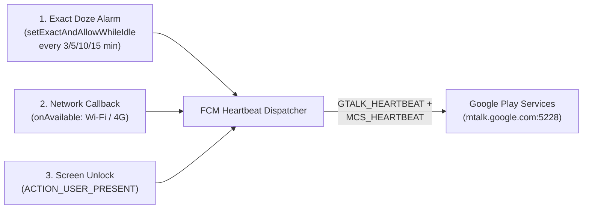

# GiuThongBao — Android FCM Push Keep-Alive & HyperOS Doze Bypass Utility

<div align="center">
  <p align="center">
    
    
    
    
  </p>
</div>

---

## ⚡ Overview

**GiuThongBao (`vn.trungthanh.giuthongbao`)** is a native Android utility written in **Kotlin + Jetpack Compose** designed to prevent delayed or dropped push notifications on aggressive Chinese OEM ROMs (especially **Xiaomi HyperOS China ROM** and **MIUI**).

> **Privacy by Design:** Despite the name (*"Keep Notifications"*), this app **does NOT use `NotificationListenerService`** and never reads, intercepts, or stores notification contents. Instead, it keeps the underlying **Google Firebase Cloud Messaging (FCM / MCS `mtalk.google.com:5228`)** TCP socket alive.

---

## 🔧 How It Works

On aggressive OEM battery-saver ROMs, background freezer mechanisms frequently sever Google Play Services' (`com.google.android.gms`) persistent TCP connection to `mtalk.google.com:5228` during Wi-Fi ↔ 4G/5G handoffs or deep sleep without scheduling a reconnect alarm.

**GiuThongBao** solves this through a 3-pronged wake & heartbeat architecture:



1. **Periodic Doze-Piercing Heartbeats (`AlarmManager.setExactAndAllowWhileIdle`):** Fires at a user-configurable interval (`3`, `5`, `10`, or `15` minutes) even when the device is in Deep Doze.
2. **Event-Driven Instant Recovery (`KeepService` ForegroundService):** Listens for the two exact moments FCM sockets drop most often—**new network availability (`NetworkCallback.onAvailable`)** and **device unlock (`ACTION_USER_PRESENT`)**—and immediately dispatches `com.google.android.intent.action.GTALK_HEARTBEAT` and `com.google.android.intent.action.MCS_HEARTBEAT`.
3. **HyperOS / MIUI Deep-Link Setup Wizard:** Provides one-tap intents directly into hidden Xiaomi system screens (`AutoStartManagementActivity`, `HIDDEN_APPS_CONFIG_ACTIVITY`) so users can whitelist background execution in seconds.

---

## 🚀 Build & Install

```powershell
git clone https://github.com/Tthanh2k6/GiuThongBao.git
cd GiuThongBao
.\gradlew.bat :app:assembleDebug
adb install -r app/build/outputs/apk/debug/app-debug.apk
```

---

**Author:** **Trung Thanh Tran** (*Trần Trung Thành*) · [GitHub `@Tthanh2k6`](https://github.com/Tthanh2k6) · [Upwork Profile](https://www.upwork.com/freelancers/~01ee7c2348cb4b62fe)
