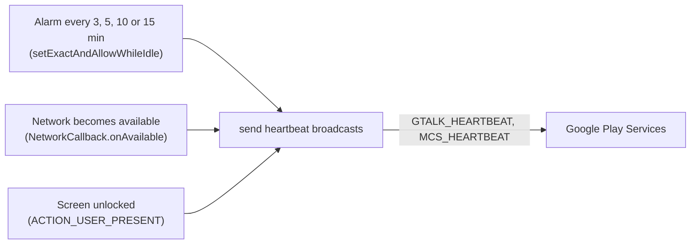

# GiuThongBao

A small Android app (Kotlin, Jetpack Compose) for a problem I had on a Xiaomi phone with the China HyperOS ROM: push notifications arrived late or not at all. The usual explanation is that the ROM's battery saver cuts Google Play Services' push connection (`mtalk.google.com:5228`) and it is not re-established until something wakes it.

GiuThongBao ("keep notifications") does not read notifications and does not use `NotificationListenerService`. It sends the heartbeat broadcasts that ask Play Services to refresh its push connection, at three moments:



- An exact alarm that also fires in Doze, at the interval you pick.
- A foreground service (`KeepService`) that listens for a new network and for the screen being unlocked.
- Buttons that open Xiaomi's autostart and battery settings screens (`AutoStartManagementActivity`, `HIDDEN_APPS_CONFIG_ACTIVITY`), because the app itself gets killed unless it is allowed to run in the background.

## Limits

The app cannot see Play Services' socket, so it never checks whether the connection is actually up. Whether the broadcasts help depends on the ROM and the Play Services version. I have only used it on one Xiaomi phone and have not measured delivery delays before and after.

## Build

Android 8.0 or newer (API 26 to 36).

```powershell
git clone https://github.com/Tthanh2k6/GiuThongBao.git
cd GiuThongBao
.\gradlew.bat :app:assembleDebug
adb install -r app/build/outputs/apk/debug/app-debug.apk
```

## Author

Trung Thanh Tran, [GitHub](https://github.com/Tthanh2k6)
